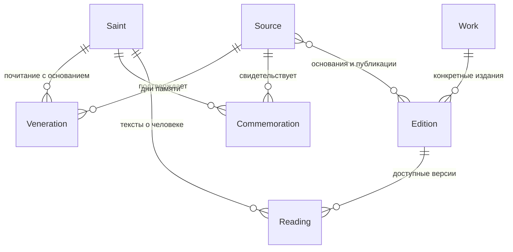

# Архитектура Saints Life

## Решение для прототипа

Next.js App Router, React, TypeScript и обычный CSS. Серверные страницы читают проверенные локальные данные. Интерактивность вынесена в небольшие клиентские компоненты календаря и читалки. Поиск каталога работает через GET-параметры и серверную фильтрацию, ссылки на выборку можно сохранять и пересылать.

База данных и CMS сейчас не нужны: начальная коллекция маленькая, а текстовые файлы удобно проверять в diff. Доступ к данным сосредоточен в `src/lib/repository.ts`. При росте библиотеки этот слой можно заменить чтением из PostgreSQL, не меняя смысл предметных сущностей. Это дальнейшая возможность, не зависимость текущего проекта.

## Главная модель

- `Saint`: идентичность человека, варианты имени, наименование и проверенные краткие сведения. ID не является именем: тёзки сохраняются раздельно.
- `Veneration`: связь человека и традиции с источником и оговоркой об области подтверждения. Нет общего флага «православный/неправославный». Метка старообрядческого портала не равна признанию всеми согласиями. Для расширения нужны конкретные идентификаторы РПСЦ, РДЦ, ДПЦ и иных общин.
- `Commemoration`: человек, традиция, основание и правило даты. Индивидуальная память, перенесение мощей и соборная память являются разными записями.
- `Work`: авторское произведение. Труд Димитрия Ростовского и труд Филарета Черниговского являются разными произведениями.
- `Edition`: язык, издатель, конкретная публикация, права, подтверждающие ссылки. Неизвестный переводчик или год не додумываются.
- `Reading`: текст конкретной версии, связанный с изданием и человеком. Редакционный пересказ имеет отдельное авторство. Внешняя публикация имеет `mode: external` и не содержит притворного «полного текста».
- `Source`: URL, издатель, вид источника, дата обращения, права, примечание. Локальный исследовательский архив отделён от публикуемого корпуса.

На следующем этапе полезно выделить издателей/организации, точные свидетельства по разделам/страницам, версии утверждений и редакционные статусы. Прототип уже хранит поля для источников и локаторов, но не имитирует полноту научного каталога.

## Страницы

| Маршрут | Назначение |
| --- | --- |
| `/` | Вход в библиотеку и первая коллекция |
| `/saints?q=&tradition=&rank=&reading=&page=` | Поиск и фильтры |
| `/saints/[slug]?text=` | Человек, свидетельства, дни памяти, выбор текста |
| `/calendar?date=YYYY-MM-DD&style=&tradition=` | Памяти выбранного физического дня |
| `/sources` | Реестр источников с выходными данными и оговорками |
| `/about` | Охват, метод и ограничения |

`date` в URL календаря всегда григорианская гражданская дата. Переключение стиля меняет представление, сохраняя физический день. Нет зависимости календарных вычислений от timezone браузера. Только кнопка «Сегодня» использует московский часовой пояс.

## Календарь

Применяется целочисленное преобразование в номер юлианского дня. Разница календарей не зашита как постоянные 13 дней: после февраля 2100 года она изменяется. Проверяются високосные годы, переходы месяцев и границы годов.

Фиксированные даты исходного русского месяцеслова даны по гражданскому календарю 2026 года. При сборке указателя они переводятся в юлианские месяц и день, которые затем повторяются в календаре источника. Это явное допущение для конкретного русского месяцеслова, а не правило для всех православных церквей. Оно не должно применяться к новым источникам без проверки.

Переходящие события хранят `kind: unresolved`. Наблюдаемая дата текущего года не превращается в ежегодный праздник. Будущее расширение: проверяемые правила относительно Пасхи, дня недели и региональных соборов с отдельным тестом для каждого правила и традиции. Пустая ячейка означает отсутствие материалов в подборке.

## Данные и их путь

1. Сохранить источник в соседний исследовательский архив, записать URL, дату, автора, издание, права и контрольную сумму оригинала.
2. Различить человека, произведение и конкретное издание. Не объединять тёзок по имени.
3. Добавить отдельное основание почитания и календарной даты, сохранив расхождения.
4. Подготовить собственное краткое изложение или разрешённый полный текст.
5. Сверить текст и связи, выполнить проверки и посмотреть страницы в браузере.

В начальном импорте 68 исходных записей, а не 68 доказанно уникальных людей. В указателе возможны имена-синонимы и повторы. Проверка отождествлений остаётся отдельной редакционной задачей. Три Розанова и два Троицких не объединены.

## Этапы развития

1. Дополнить источники Димитриев: точные церковные календари, патронимы тёзок, проверка возможных дублей и печатные выходные данные.
2. Добавить проверенные полные тексты общественного достояния и отдельные издания, сопоставление двух текстов в читалке.
3. Расширить перечень имён и старообрядческих согласий; добавить вычисляемые календарные правила.
4. При реальной потребности подключить редакторский интерфейс и PostgreSQL. Базовые таблицы следуют текущей модели; полнотекстовый поиск можно начать средствами PostgreSQL.
5. Авторизация и синхронизация нужны только для личной библиотеки между устройствами. До этого закладки локальны.

Микросервисы, внешние поисковые движки, платёжные системы и автоматический массовый AI-пересказ для первого этапа не требуются. Production-деплой и домен не настраивались.
