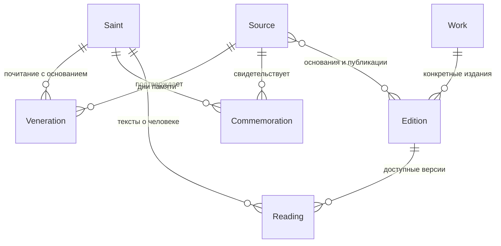

# Архитектура Saints Life

Справочник традиций включает Римско-католическую церковь. Для Евагрия Константинопольского основанием служит явно обозначенное свидетельство Православной энциклопедии о Римском мартирологе. Это не присваивает ему православную память, современный местный ранг праздника или непроверенное календарное правило. Фильтрация использует обычную отдельную запись почитания с источником.

Завершённая редакционная сверка именованных святых отдельного произведения записывается в `reviewed-work-person-coverage.json`: заголовок, издание, непрерывный список проверенных страниц с SHA-256, полный список идентифицированных святых и пояснение границ текста. Отчёт покрытия отмечает `reviewed-named-saints` только при совпадении всех страниц и точного состава персон со ссылками произведения. Ссылка на заголовок сама по себе такого статуса не даёт. Это запись ручной сверки конкретного текста, а не автоматическое доказательство полноты корпуса; остальные разделы сохраняют свои нерешённые статусы.

Подготовка локального поиска имён принимает `--books` с номерами книг из OCR-базы. По умолчанию сохраняется выбор томов 1-12; отдельная очередь для книги 13 готовится через `prepare --run john-v1 --books 13 --limit 0`. В манифесте записывается выбранный список книг. Неизвестные номера, пустая выборка и перезапись существующего запуска отклоняются. Подготовка очереди не запускает модель и не означает проверки всех имён книги.

В общий справочник традиций добавлена Сербская православная церковь. Она используется существующими фильтрами без изменения календарных правил. Свидетельства Елены и Уроша из церковной общины Котора не наследуют даты русского месяцеслова и коллективные памяти книг Ростовского.

Список традиций вынесен в `src/domain/traditions.ts` и используется каталогом и календарём. Добавлена Армянская апостольская церковь: свидетельство Авгаря основано на официальной публикации Эчмиадзина. Наблюдаемое празднование в 2012 году не создаёт ежегодного календарного правила. Коллективные памяти из книг Ростовского показываются только без фильтра традиции либо в православном месяцеслове; другие традиции не наследуют эти записи.

Правило `myrrhbearers` вычисляет третью Неделю по Пасхе как 14 прошедших дней после юлианской Пасхи. Оно использует тот же расчёт Пасхи и целые юлианские номера дней, что другие пасхальные правила; отображение в старом и новом стиле относится к одному физическому дню. Список людей и свидетельства традиции остаются отдельными данными с источниками, правило не присваивает память всем мироносицам автоматически.

Между титулом и именем допускается одно определение «Христов» или «Божий» в явно перечисленных формах. Определение сохраняется в `excludedTerms`, следующее имя становится отдельной буквальной подсказкой. Граница между ними допускает пробельные символы, но не пунктуацию. Определения без следующего имени также остаются в журнале исключений; имена с похожим началом и имена с дефисом не исключаются по префиксу. Это расширение поиска, не автоматическая идентификация.

Отчёт `mine-person-candidates.py check` содержит `bookProgress`: для каждой книги выбранного запуска считаются входные, проверенные, отсутствующие и некорректные фрагменты, а также страницы с полностью, частично или ещё не проверенными входными фрагментами. Страница считается полностью проверенной только после проверки всех её выбранных фрагментов. Это не статус OCR, не проверка идентичности и не полнота книги: не включённые в запуск книги и страницы не входят в знаменатель.

Поддерживаются также самостоятельные титулы «мученик», «мученица», «священномученик», «священномученица», «преподобномученик», «преподобномученица», «исповедник» и «исповедница» в перечисленных в алгоритме падежных формах. Дополнительное слово «святой» перед ними не требуется. Прилагательные и вхождения внутри другого слова не совпадают. Такие подсказки тоже требуют проверки: имя после титула может оказаться адресатом речи, а не носителем титула.

Искатель имён после титулов исключает закрытый список падежных форм слов «Церковь», «Крест», «Пасха», «Четыредесятница», «Пятидесятница», «Евхаристия», «Причастие», «Причащение», «Синод» в дополнение к прежним исключениям. Новые термины сопоставляются целиком, поэтому похожие имена и составные имена не отбрасываются по префиксу. Все исключённые буквальные вхождения, включая прежние исключения, сохраняются в `excludedTerms` отчёта сканирования с номерами страниц, смещениями и контрольными суммами. Это фильтрация подсказок, не решения об идентичности или почитании; исходный OCR и ручные решения не изменяются.

`npm run data:scan-titled-names` выполняет локальный проход по всем сохранённым OCR-страницам со статусом `ok`: ищет буквальные формы имён после ограниченного списка слов «святой», «преподобный», «блаженный», «праведный», «святитель» и некоторых санов. Он создаёт `reports/name-mining/titled-prefix-v1-checked.json` во внешнем архиве; очередь строится командой `npm run data:review-people -- titled-prefix-v1`. Здесь единица прохода, обозначенная совместимыми полями `inputChunks` и `completedChunks`, является сохранённой OCR-страницей, не фрагментом модели и не PDF-страницей, наличие которой ещё не проверено. Отчёт отдельно сохраняет `unit` и непросканированные страницы.

Проход сохраняет оригинальные символы и смещения в кодовых точках Unicode, SHA-256 книги и текста страницы. Он не исправляет переносы и ошибки OCR, не покрывает заголовки прописными буквами, имена без указанных слов или с другими титулами. Неперсональные слова всё ещё могут попадать в подсказки. Даже полный проход по страницам не означает полного извлечения имён или проверки святости. Используется обычная очередь ручной сверки с проверкой контрольных сумм; автоматических отождествлений нет.

Подсказки падежных форм имён в очереди сверки хранятся отдельно в `declensionSuggestedSaintIds`. Они вычисляются по первому слову канонического имени и его каталожных вариантов и покрывают только часть русских форм, включая отдельные исключения Павел и Лев. Это поисковая эвристика, не проверка личности: она не меняет буквальные совпадения, решения сверки или связи сайта. В нерешённой очереди `remainingDeclensionSuggestedSaintIds` исключает отвергнутую личность только для конкретного вхождения. Одинаковая форма женского имени и падежная форма мужского имени сохраняют независимые подсказки.

## Решение для прототипа

Next.js App Router, React, TypeScript и обычный CSS. Серверные страницы читают исходный каталог и локальную библиотеку. Интерактивность вынесена в небольшие клиентские компоненты календаря и читалки. Поиск каталога работает через GET-параметры и серверную фильтрацию, ссылки на выборку можно сохранять и пересылать.

Начальный проверенный каталог остаётся в репозитории. Книжные тексты и результаты распознавания хранятся в локальных SQLite-файлах за пределами Git: главы книг в `library.sqlite3`, сканы в `rostovskij-ocr.sqlite3` (историческое имя файла также используется для книги об Иоанне), а распознанные указатели в `book-indexes.sqlite3`. Это позволяет обрабатывать тысячи страниц без развёртывания сервера БД и устанавливать проект без дополнительных рабочих зависимостей. Источник истины для распознанной страницы: идентификатор книги, страница PDF, SHA-256 исходного PDF, текст OCR и статус обработки. Полнотекстовый индекс FTS5 поддерживается в той же транзакции, что и текст страницы.

Доступ к начальному каталогу сосредоточен в `src/lib/repository.ts`; к библиотеке в `src/lib/book-db.ts` и `src/lib/ocr-db.ts`. Серверные страницы открывают БД только для чтения. Печатные алфавитные указатели обрабатываются отдельно, поисковая выдача сохраняет ссылку на скан каждой строки и не превращает совпадения в проверенные карточки. Ручная проверка колонтитулов и сопоставление тёзок с отдельными персонами остаются редакционной задачей. При развёртывании многопользовательского сервиса возможно перенести те же сущности в PostgreSQL; SQLite-файлы и исходные сканы не попадают автоматически в публичный репозиторий.

Поиск по всем книгам также предлагает переходы к автоматически обнаруженным заголовкам разделов. FTS выбирает страницы-кандидаты, после чего проверяются заголовки и исходный номер раздела на странице. Это поисковая подсказка, а не идентификация святого или сверенное оглавление; ошибки OCR могут скрывать совпадения. Скан исходной страницы доступен рядом со ссылкой.

Строки печатного указателя хранятся в `printed_entries` как записи конкретной страницы и строки OCR со статусом проверки, контрольной суммой источника и исходным текстом. Повторная сборка не перезаписывает проверенные записи и прерывается, если исходная строка такой записи изменилась.

## Главная модель

Команда `data:review-people` сохраняет дополнительный отчёт `reports/name-mining/<run>-pending.json` во внешнем архиве. Он строится после проверки контрольных сумм и ручных решений: подтверждённые связи и записи `not-person` исключаются, а `identity-rejected` остаются в работе. Отклонённые идентификаторы убираются только из подсказок конкретного вхождения, не из других упоминаний того же имени. Отчёт содержит отдельные счётчики по книгам и сохраняет сведения о числе обработанных фрагментов. Число нерешённых вхождений не равно числу отсутствующих святых и не доказывает полноту книг.

Очередь проверки имён повторно использует ручное решение для короткого имени только внутри уже проверенного полного имени: совпадают книга, страница, начальная позиция, контрольные суммы издания и OCR; полное имя буквально присутствует в проверенном контексте, а короткое заканчивается перед пробелом. Решение должно связывать ровно одну персону. Точное решение имеет приоритет; конкурирующие полные записи, отрицательные решения и коллективные сопоставления не наследуются. Поля `reviewMatch` и `inheritedOccurrences` отделяют это повторное использование от новых ручных решений; оригинальная запись с полным именем сохраняется. Это правило не устанавливает личность нового человека и не распространяет решение на другие вхождения имени.

Правило `cheesefare-saturday` вычисляет Сырную субботу как день за 50 суток до Пасхи по юлианской пасхалии. Преобразование в гражданскую дату использует номера юлианских дней, а не постоянное прибавление 13 суток. Правило подключается только к подтверждённой памяти конкретной персоны и традиции. Контрольные даты 2025 и 2026 годов сверены с календарём OCA; страницы и контрольные суммы сохранены в архиве `reviews/cheesefare-calendar.json`. Эти календарные примеры не служат основанием для назначения человеку дополнительной церковной традиции.

Коллективная память хранится отдельно от человека: название группы, книжная дата по старому стилю, издание, страница, точный якорь и пояснение. Она не увеличивает число индивидуальных карточек. Ссылки на чтение доступны только при совпадении контрольной суммы издания и уникального якоря; для развёрнутого текста проверяется также заголовок. В библиотеке такие записи участвуют в поиске, а календарь показывает их отдельным блоком. Книжное свидетельство не переносится на старообрядческую традицию автоматически.

Карточки из дополнения к Собору апостолов могут опираться непосредственно на книжный источник `local-rostov`. Свидетельство почитания ограничено конкретным изданием. Отсутствие даты не мешает поиску и чтению карточки; переходящие памяти без проверенного вычисления сохраняются как `unresolved`. Основной перечень Собора и дополнительные рассказы проверяются раздельно: связь с главой не назначает всем её участникам дату 4 января.

- `Saint`: идентичность человека, варианты имени, наименование и проверенные краткие сведения. ID не является именем: тёзки сохраняются раздельно.
- `Veneration`: связь человека и традиции с источником и оговоркой об области подтверждения. Нет общего флага «православный/неправославный». Метка старообрядческого портала не равна признанию всеми согласиями. Для расширения нужны конкретные идентификаторы РПСЦ, РДЦ, ДПЦ и иных общин.
- `Commemoration`: человек, традиция, основание и правило даты. Индивидуальная память, перенесение мощей и соборная память являются разными записями.
- `Work`: авторское произведение. Труд Димитрия Ростовского и труд Филарета Черниговского являются разными произведениями.
- `Edition`: язык, издатель, конкретная публикация, права, подтверждающие ссылки. Неизвестный переводчик или год не додумываются.
- `Reading`: текст конкретной версии, связанный с изданием и человеком. Редакционный пересказ имеет отдельное авторство. Внешняя публикация имеет `mode: external` и не содержит притворного «полного текста».
- `Source`: URL, издатель, вид источника, дата обращения, права, примечание. Локальный исследовательский архив отделён от публикуемого корпуса.

На следующем этапе полезно выделить издателей/организации, точные свидетельства по разделам/страницам, версии утверждений и редакционные статусы. Прототип уже хранит поля для источников и локаторов, но не имитирует полноту научного каталога.

## Страницы

| Маршрут | Назначение |
| --- | --- |
| `/` | Вход в библиотеку и первая коллекция |
| `/saints?q=&tradition=&rank=&reading=&page=` | Поиск и фильтры |
| `/saints/[slug]?text=` | Человек, свидетельства, дни памяти, выбор текста |
| `/calendar?date=YYYY-MM-DD&style=&tradition=` | Памяти выбранного физического дня |
| `/sources` | Реестр источников с выходными данными и оговорками |
| `/about` | Охват, метод и ограничения |
| `/library` | Книжная коллекция и поиск по распознанным страницам |
| `/library/index` | Предварительный указатель по колонтитулам, он не заменяет проверенные карточки святых |
| `/library/entry/[book]/[page]/[line]` | Отдельная запись печатного указателя с источником, сканом, предварительной датой и возможным переходом к тексту |
| `/library/collection/[book]` | Оглавление полностью извлечённой книги |
| `/library/john` | Содержание книги об Иоанне Шанхайском: сверенные главы жизнеописания и OCR полного печатного содержания со сканами |
| `/library/john/[chapter]` | Глава жизнеописания с сохранением страниц и ссылок на сканы |
| `/library/book/[book]/[page]` | Текст страницы OCR и ссылка на её скан |
| `/library/book/[book]/[page]/continuous` | Чтение десяти страниц подряд со ссылкой на оригинал каждой страницы |
| `/library/book/[book]/[page]/day` | Чтение книжного дня до следующего заголовка или сверенного конца тома, с разбиением на части по 40 страниц |
| `/library/book/[book]/[page]/work/[section]` | Предварительно выделенный по заголовкам раздел, со сканами страниц и явными ограничениями OCR |
| `/api/library/book/[book]/[page]` | Локальное изображение указанной страницы исходного PDF |
| `/api/library/chapter/[id]/scan?page=` | Страница источника главы, в пределах подтверждённого диапазона PDF |

`date` в URL календаря всегда григорианская гражданская дата. Переключение стиля меняет представление, сохраняя физический день. Нет зависимости календарных вычислений от timezone браузера. Только кнопка «Сегодня» использует московский часовой пояс.

## Календарь

Правила `second-sunday-lent` и `second-sunday-after-pentecost` вычисляют второе воскресенье Великого поста и второе воскресенье по Пятидесятнице как день за 35 суток до Пасхи и через 63 суток после Пасхи по юлианской пасхалии. Они используют тот же расчёт Пасхи, что и Сырная суббота, с преобразованием через номера юлианских дней. Контрольные даты 2025 и 2026 годов сверены с календарём OCA; оригиналы и контрольные суммы сохранены в `reviews/synaxis-calendar.json`. Правила подключены только к уже подтверждённым источниками памятям; календарь OCA служит проверкой даты, а не новым основанием почитания конкретной персоны.

Для Недели святых праотцев введено правило `forefathers`: воскресенье в диапазоне 11-17 декабря юлианского календаря. Для Ноя оно подтверждено статьёй «Ной» Православной энциклопедии, разделом «Гимнография». Дата рассчитывается для выбранного года; фиксированная дата конкретного календаря не копируется. В отличие от памяти Богоотцов после Рождества, в поддерживаемом диапазоне лет эта память приходится на декабрь того же гражданского года.

Применяется целочисленное преобразование в номер юлианского дня. Разница календарей не зашита как постоянные 13 дней: после февраля 2100 года она изменяется. Проверяются високосные годы, переходы месяцев и границы годов.

Фиксированные даты исходного русского месяцеслова даны по гражданскому календарю 2026 года. При сборке указателя они переводятся в юлианские месяц и день, которые затем повторяются в календаре источника. Это явное допущение для конкретного русского месяцеслова, а не правило для всех православных церквей. Оно не должно применяться к новым источникам без проверки.

Для памяти Богоотцов после Рождества введено `kind: after-nativity`: ближайшее воскресенье после 25 декабря юлианского календаря, а при воскресном Рождестве 26 декабря. Правило подтверждено примечанием книги 4 на PDF 692. Карточка показывает январскую гражданскую дату выбранного года, календарь сопоставляет физический день с юлианским годом. Остальные несверенные переходящие события хранят `kind: unresolved`. Наблюдаемая дата текущего года не превращается в ежегодный праздник. Будущее расширение: проверяемые правила относительно Пасхи, дня недели и региональных соборов с отдельным тестом для каждого правила и традиции. Пустая ячейка означает отсутствие проверенных записей в подборке.

При выборе всех традиций календарь отдельно показывает предварительные строки из печатных указателей томов Ростовского. Месяц берётся с титульного листа тома, день считается датой по старому стилю. Если на странице книги найдено имя и её можно отнести к разделу между двумя последовательными заголовками дней без пропусков страниц, день берётся из заголовка раздела; иначе используется автоматически распознанное число из указателя. При расхождении показывается пометка и ссылка на скан заголовка. Распознавание может ошибаться, поэтому строки не добавляются к проверенным памятям и не создают отметку традиции; в сетке они обозначаются отдельным квадратом. Каждая строка содержит ссылку на скан указателя. При фильтре конкретной традиции предварительные строки скрываются.

Для чтения выбранного дня календарь предлагает переход к странице его начала по отдельному заголовку, если номер уникален и соседние распознанные заголовки не нарушают порядок дней. Следующий день и граница раздела для такого перехода не требуются. Неоднозначные повторяющиеся заголовки исключаются. Это предварительная навигация по конкретному изданию, а не проверенная дата почитания; ссылка скрыта при фильтре традиции или имени, поскольку сам заголовок их не подтверждает. Для определения дня конкретной записи указателя по-прежнему требуется непрерывный диапазон между последовательными заголовками.

Последние дни томов заканчиваются перед указателем или приложениями. Эти двенадцать границ сверены по сканам и применяются только при совпадении контрольной суммы книги, распознанного начала дня, заголовка границы и наличия всех страниц диапазона. Приложения сохраняются в книге, но не приписываются автоматически последнему календарному дню.

Когда OCR слил числа дня и страницы, заменив вертикальную черту цифрой «1», система рассматривает допустимые варианты разбиения. Номер предлагается только при единственном варианте, для которого найден подходящий заголовок на странице книги или в ближайшем непрерывном разделе. В выдаче сохраняются исходная строка и пометка об автоматическом восстановлении; это не замена редакторской проверке.

## Данные и их путь

1. Сохранить источник в соседний исследовательский архив, записать URL, дату, автора, издание, права и контрольную сумму оригинала.
2. Различить человека, произведение и конкретное издание. Не объединять тёзок по имени.
3. Добавить отдельное основание почитания и календарной даты, сохранив расхождения.
4. Подготовить собственное краткое изложение или разрешённый полный текст.
5. Сверить текст и связи, выполнить проверки и посмотреть страницы в браузере.

Первый импорт детской книги включает 28 глав. Для сорока двух однозначных персон связь с главой и календарным источником проверена вручную. Персоны из групповых глав добавляются только после сверки имён и календарного источника; колонтитулы не превращаются в карточки персон автоматически. EPUB-фрагменты исключены из пользовательской выдачи по пожеланию владельца; их исходная локальная запись сохранена для возможной дальнейшей работы.

В начальном импорте 68 исходных записей, а не 68 доказанно уникальных людей. В указателе возможны имена-синонимы и повторы. Проверка отождествлений остаётся отдельной редакционной задачей. Три Розанова и два Троицких не объединены.

## Этапы развития

1. Дополнить источники Димитриев: точные церковные календари, патронимы тёзок, проверка возможных дублей и печатные выходные данные.
2. Добавить проверенные полные тексты общественного достояния и отдельные издания, сопоставление двух текстов в читалке.
3. Расширить перечень имён и старообрядческих согласий; добавить вычисляемые календарные правила.
4. При реальной потребности подключить редакторский интерфейс и PostgreSQL. Базовые таблицы следуют текущей модели; полнотекстовый поиск можно начать средствами PostgreSQL.
5. Авторизация и синхронизация нужны только для личной библиотеки между устройствами. До этого закладки локальны.

Микросервисы, внешние поисковые движки, платёжные системы и автоматический массовый AI-пересказ для первого этапа не требуются. Production-деплой и домен не настраивались.

Заголовок «СЛОВО на ПОКРОВ» распознаётся при строчном предлоге внутри прописной строки. Послабление применяется только к начальному сочетанию «СЛОВО на» перед прописной буквой; заголовок и OCR сохраняются в исходном виде. Обычные предложения со строчными словами не становятся разделами.
